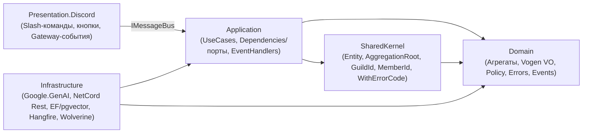

# 01. Чистая архитектура и конвенции (по образцу `care-call1/develop`)

Архитектура `DiscordGeminiAdmin` построена по канонам сервиса `appointment` из эталонного проекта `C:\care-call1` (ветка `develop`).

## 1. Слои и правило зависимостей

Запрещённые направления зависимостей проверяются **на этапе компиляции** Roslyn-анализатором `DGA.Analyzer` (`DGA0001`, порт `CC.Analyzer`), настроенным в `.editorconfig`:

| Слой (сегмент namespace) | Запрещено ссылаться на (`dotnet_code_quality.DGA0001.<Layer>`) |
|---|---|
| `Domain` | `Application, Infrastructure, Presentation` |
| `Application` | `Infrastructure, Presentation` |
| `Infrastructure` | `Presentation` |
| `Presentation` | `Infrastructure` (вызывает `Application` только через `IMessageBus`) |

## 2. Ключевые паттерны из `care-call1`

1. **Use Case как статический обработчик Wolverine (`*UseCase`):**
   - Команда (`public sealed record <Action>`) и обработчик (`public static class <Action>UseCase`) лежат в одном файле `Application/UseCases/<Module>/<Action>/<Action>UseCase.cs`.
   - Сигнатура: `public static async ValueTask<Result> Handle(<Action> command, ...порты..., DateTime now, CancellationToken cancellationToken)`.
   - Wolverine автоматически находит все классы с суффиксом `UseCase` и подставляет сервисы, `DateTime now` и `CancellationToken`.
2. **Доменная модель (`AggregationRoot<Guid>` + Vogen + `FluentResults`):**
   - Фабричные методы `Create(...)` / `Open(...)` и бизнес-методы возвращают `Result` / `Result<T>` вместо выбрасывания исключений.
   - Идентификаторы агрегатов — `Guid.CreateVersion7()`.
   - Примитивы с инвариантами (`GuildId`, `MemberId`, `Confidence`, `ModerationReason`, `RuleReference`) оформляются как `[ValueObject<T>] public readonly partial struct` (библиотека **Vogen**).
   - Ошибки группируются в статических классах `<Aggregate>Errors` и снабжаются кодом через `.WithErrorCode("M101")`.
3. **Порты и адаптеры:**
   - Репозитории агрегатов объявляются в `Domain/<Aggregate>/Repositories/I<Aggregate>Repository.cs`.
   - Порты внешних систем (`IGuildGateway`, `IModerationAi`, `IStructureAdvisorAi`, `IKnowledgeIndex`, `IEmbeddingService`, `IUnitOfWork`) объявляются в `Application/Dependencies/<Area>/`.
   - Реализации (`internal sealed class`) живут в `Infrastructure/` и регистрируются через C# 14 `extension(IServiceCollection services)` блоки в `DependencyInjection.cs`.
4. **Транзакции и доменные события:**
   - `IUnitOfWork.SaveAsync` вызывает `IDbContextOutbox<DatabaseContext>.SaveChangesAndFlushMessagesAsync`.
   - Доменные события из `AggregationRoot.DomainEvents` публикуются через Wolverine outbox в рамках одной транзакции БД.
