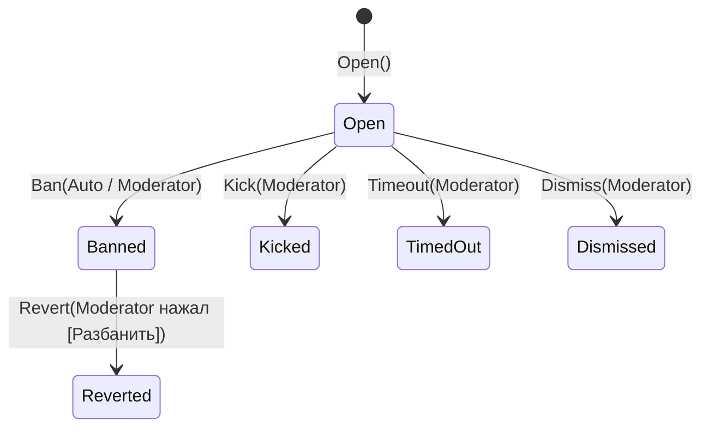

# 02. Логика и фичи ИИ-модератора и организатора сервера

Бот решает три главные задачи:
1. **Модерация (часовой ИИ-прогон + авто-бан при высокой уверенности + часовой дайджест с кнопками).**
2. **RAG-база знаний сервера** (правила, тематика, FAQ, прецеденты решений модераторов).
3. **Организация структуры сервера по тематике** (анализ каналов/категорий/ролей и применение `StructureProposal` после одобрения).

---

## 1. Модуль `Moderation` и `Digests` (часовой прогон и авто-бан)

### Поток выполнения раз в час (`RunHourlyModerationUseCase`)

1. **Буферизация сообщений (`IngestMessageUseCase`):**
   - По событию Gateway `MessageCreate` сообщения обычных участников (не ботов) сохраняются в буфер БД со сроком хранения `Retention:MessageBufferHours = 24`.
   - Фоновая джоба `RetentionCleanupJob` удаляет записи старше 24 часов.
2. **Часовой анализ (`HourlyModerationJob`, cron `0 * * * *`):**
   - Загружает сообщения гильдии за последний час и группирует по авторам.
   - Для подозрительных паттернов достаёт из RAG (`IKnowledgeIndex`) релевантные пункты правил сервера и прошлые прецеденты модерации.
   - Вызывает `IModerationAi.AssessBatchAsync` (Gemini со строгой JSON-схемой, `Temperature = 0`).
   - Для каждого выделенного участника создаёт `ModerationCase` (`Confidence`, `ModerationReason`, `RuleReference?`, `EvidenceCount`).
3. **Принятие решения (`ModerationPolicy.CanAutoBan`):**
   - Если все предохранители пройдены и `Confidence >= AutoBan:MinConfidence` (`0.95`), вызывается `BanMemberUseCase` с `BanSource.Auto`:
     - участник банится через `IGuildGateway.BanAsync`;
     - в мод-канал отправляется карточка аудита с причиной, правилом и кнопкой **`[Разбанить]`** (`custom_id = "unban:<caseId>"`).
   - Все остальные открытые кейсы (`0.50 <= Confidence < 0.95`, либо заблокированные лимитом/dry-run) собираются в **`HourlyDigest`** и публикуются одним сообщением-отчётом в мод-канал с кнопками под каждым кейсом:
     - **`[Бан]`** (`ban:<caseId>`)
     - **`[Кик]`** (`kick:<caseId>`)
     - **`[Таймаут 1ч]`** (`timeout:<caseId>`)
     - **`[Игнор]`** (`dismiss:<caseId>`)

### Предохранители авто-бана (включены по умолчанию)

| Проверка в `ModerationPolicy` | Условие по умолчанию | Код отказа | Что происходит при отказе |
|---|---|---|---|
| Защищённый участник (`MemberProfile.IsProtected`) | Владелец сервера, бот, стафф (права `Administrator / ManageGuild / BanUsers / KickUsers / ModerateUsers / ManageMessages`), либо роль `>=` роли бота | `M101` | Авто-бан запрещён |
| Ссылка на правило из RAG (`RuleReference`) | Обязательна и должна существовать в RAG этой гильдии | `M103` | Кейс уходит в часовой дайджест человеку |
| Порог уверенности и доказательств | `MinConfidence = 0.95`, `MinEvidenceMessages = 3` | `M102` | Кейс уходит в часовой дайджест человеку |
| Часовой лимит авто-банов на гильдию | `MaxPerHour = 3` | `M104` | Кейс уходит в часовой дайджест человеку |
| Режим `DryRun` | `DryRun = true` на старте | `M105` | Бот не банит, а помечает в дайджесте «[DRY-RUN] Был бы забанен автоматически» |

### Состояния `ModerationCase`

---

## 2. Модуль `Knowledge` (RAG по серверу)

- **Что хранится в RAG (`KnowledgeDocument` + `KnowledgeChunk`):**
  1. `Rules` — правила сервера (добавленные через `/kb add` или собранные из канала правил).
  2. `ThemeAndFaq` — описание тематики сервера, FAQ, гайды.
  3. `ChannelGuide` — назначения каналов и ролей (индексируются командой `/kb reindex`).
  4. `Precedent` — обезличенные прецеденты решений модераторов (когда модератор нажал `[Бан]`, `[Игнор]` или `[Разбанить]`, бот запоминает, что считается нарушением, а что ложным срабатыванием).
- **Как используется:**
  - Участники и модераторы могут спрашивать бота через `/ask <вопрос>` — бот отвечает строго по базе знаний сервера с указанием источников (`RuleCode`).
  - Часовой модератор подтягивает правила и прецеденты перед оценкой сообщений.
  - Организатор сервера учитывает тематику и существующие каналы.

---

## 3. Модуль `Structure` (ИИ-организатор сервера по тематике)

- По команде `/organize analyze [пожелания]` (`AnalyzeGuildStructureUseCase`):
  1. Бот снимает текущее дерево категорий, каналов и ролей гильдии + тематику из `GuildProfile` и RAG.
  2. `IStructureAdvisorAi` предлагает план улучшений (`StructureProposal`), состоящий из атомарных шагов `ProposedChange`:
     - `CreateCategory`, `CreateTextChannel`, `CreateVoiceChannel`, `CreateForumChannel`
     - `UpdateChannelTopic`, `RenameChannel`, `MoveChannelToCategory`
     - `CreateRole` (без опасных прав администратора)
  3. Бот публикует `StructureProposal` в мод-канал с описанием каждого шага и кнопками **`[Одобрить план]`** (`proposal-approve:<proposalId>`) и **`[Отклонить]`** (`proposal-reject:<proposalId>`).
  4. Только после нажатия **`[Одобрить план]`** администратором `ApplyStructureProposalUseCase` последовательно выполняет шаги через `IGuildGateway` и пишет лог созданных объектов.

---

## 4. Сводный каталог кодов ошибок

| Код | Константа | Смысл |
|---|---|---|
| `G201` | `GuildErrors.NotConfigured` | Гильдия ещё не настроена (`/mod setup`) |
| `K101` | `KnowledgeErrors.DocumentTooLarge` | Документ превышает допустимый размер |
| `K201` | `KnowledgeErrors.DocumentNotFound` | Документ базы знаний не найден |
| `M101` | `ModerationErrors.ProtectedMember` | Участник защищён от авто-модерации |
| `M102` | `ModerationErrors.BelowThreshold` | Уверенность ИИ или число сообщений ниже порога |
| `M103` | `ModerationErrors.RuleReferenceMissing` | Нет подтверждённой ссылки на правило из RAG |
| `M104` | `ModerationErrors.AutoBanLimitReached` | Превышен лимит авто-банов за час |
| `M105` | `ModerationErrors.DryRun` | Включён режим DryRun (реальный бан не выполняется) |
| `M201` | `ModerationErrors.CaseNotFound` | Кейс модерации не найден |
| `M202` | `ModerationErrors.InvalidStatusForBan` | Кейс уже закрыт, повторный бан невозможен |
| `M203` | `ModerationErrors.InvalidStatusForRevert` | Разбанить можно только кейс в статусе `Banned` |
| `D201` | `DigestErrors.NotFound` | Часовой дайджест не найден |
| `S101` | `StructureErrors.EmptyProposal` | План изменений пуст |
| `S201` | `StructureErrors.ProposalNotFound` | План изменений не найден |
| `S202` | `StructureErrors.InvalidStatusForApprove` | План уже обработан |
